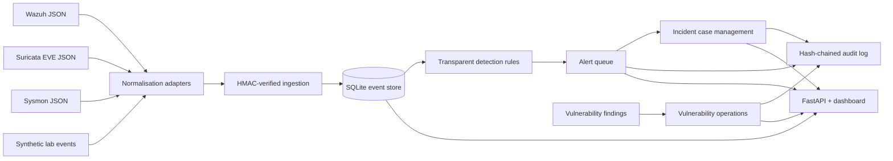

# SOCForge architecture

## Purpose

SOCForge is a local, defensive security-operations laboratory. It demonstrates telemetry normalisation, integrity-protected ingestion, transparent detection rules, alert triage, incident records, vulnerability tracking and tamper-evident audit history. It is not a production SIEM, an EDR product or a replacement for a managed SOC.

## Data flow

## Trust boundaries

- All integrations are treated as untrusted input.
- Ingestion endpoints require an HMAC-SHA256 signature over the exact HTTP request body by default.
- The API validates incoming fields with Pydantic and stores the original mapped attributes as JSON.
- HMAC provides integrity and shared-secret authentication between a trusted sender and this lab API. It does not provide user identity, non-repudiation or confidentiality.
- The dashboard is read-only. Analyst state changes are made through the documented API endpoints.
- The audit chain detects modification, insertion or deletion in the local audit sequence when verification is run. It is not externally anchored and therefore cannot protect against an administrator who can rewrite the database and recompute the entire chain.

## Components

| Component | Responsibility |
|---|---|
| `normalizer.py` | Maps representative Wazuh, Suricata EVE and Sysmon JSON into a common schema |
| `security.py` | HMAC signing and constant-time signature verification |
| `detections.py` | Small, inspectable detection rules with ATT&CK references |
| `service.py` | Event storage, rule evaluation, deduplication, alert/case/vulnerability workflow |
| `audit.py` | SHA-256 hash-chained operational audit records |
| `api.py` | FastAPI endpoints and a lightweight browser dashboard |
| `simulator.py` | Benign synthetic telemetry using RFC 5737 documentation IP ranges |

## Production hardening required

Before any real organisational use, add SSO/OIDC and role-based access control, TLS termination, secrets management, rate limiting, tenant isolation, database backups, retention controls, immutable external audit storage, robust schema versioning, queue-based ingestion, observability, high availability and formal security testing. Do not expose this training application directly to the public internet.
